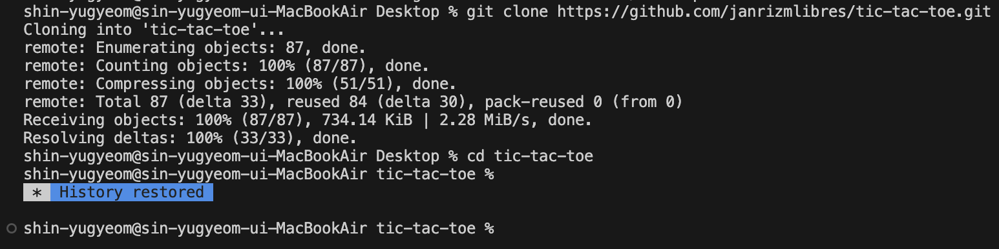
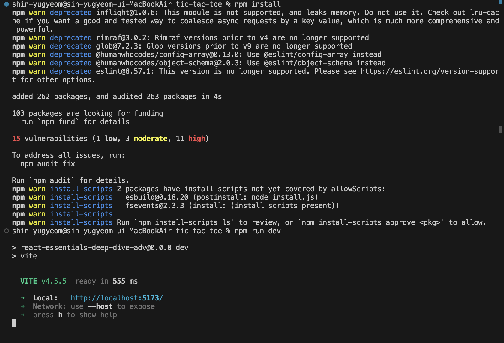
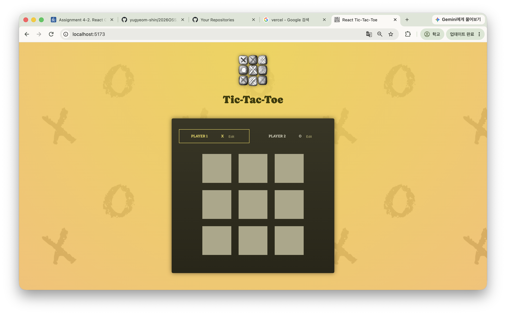

## Project Information: 프로젝트 소개, 선택 이유, 원본 GitHub URL 및 라이선스
- 프로젝트 소개 : 틱택톡 게임, 3x3 게임판에 번갈아 가며 x와 o를 놓는 게임
- 선택 이유 : 평소에 간단하게 하기 좋은 게임이라 익숙해서 선택하게 되었습니다.
- 원본 GitHub URL 및 라이선스 : https://github.com/janrizmlibres/tic-tac-toe.git

## Installation: 설치·실행 방법 및 실행 화면
git clone https://github.com/janrizmlibres/tic-tac-toe.git  
cd tic-tac-toe  
npm install  
npm run dev  

## Source Code Exploration: 주요 파일, 컴포넌트, 코드 분석
### Project Structure: 주요 파일 2~3개의 역할
- App.jsx : 전체적인 진행 역할. 순서, 승자와 패자를 결정
- helpers.js : 순서 계산, 우승자 계산(무승부도 계산)
- winning-combinations.js : 이기는 경우의 수들

### React Component: 주요 컴포넌트 1~2개의 역할
- GameBoard.jsx : 게임판 표시, 칸 선택
- Player.jsx : 이름 수정 가능

### Code Analysis: 코드 1개(약 5~15줄)를 선택하여 동작 원리 설명
#### App.jsx
  function handleCellClick(row, col) {
    setGameTurns((prevTurns) => {
      const currentPlayer = deriveActivePlayer(prevTurns, symbols);

      const updatedTurns = [
        { square: { row, col }, player: currentPlayer },
        ...prevTurns,
      ];

      return updatedTurns;
    });
  }
클릭하는 칸(row, col)을 알고, deriveActivePlayer()로 현재 차례인 플레이어를 안다. updatedTurns를 통해 업데이트 된 상태를 추가한다. 

## Customizing: 수정한 3가지 내용, 수정 파일명 및 전/후 결과
### Text  
- 수정 파일명 : constants.js  
- 수정 내용 : player1, player2를 각각 first turn, second turn으로 수정
- 전후 결과 : 화면에 표시된 player1, player2가 first turn, second turn으로 표시
### Style
- 수정 파일명 : index.css
- 수정 내용 :#game-board button의 background를 skyblue로 변경
- 전후 결과 :3X3 네모칸이  #aca788 색상에서 skyblue 색상으로 변경
### UI/Data
- 수정 파일명 : App.jsx
- 수정 내용 : handleCellClick 함수에서 플레이어가 최대 3개의 기호만 놓을 수 있도록, 4개째를 두려고 할 때 가장 오래된 기호가 사라지도록 수정
- 전후 결과 : 전에는 기호가 사라지지 않고 게임 종료까지 남아있다가, 후에는 3개 이상일 때 사라지고 무승부 결과는 나오지 않음

## Deployment: 실제 접근 가능한 Vercel URL
https://2026-oss-assign10-lovat.vercel.app/

## Weekly Review:
- 새롭게 배운 내용 3가지 : 
- 어려웠던 점과 해결 방법 : UI/Data에서 count는 올리나 그 값을 적용시키는 방법이 뭔지 몰랐음. return을 사용
- AI 활용 내용 및 느낀 점 : 프로젝트 선정을 위해 ai 사용, 동작원리 중 deriveActivePlayer()에 대한 이해를 위해 ai 사용, 내 과제 폴더에 react 프로젝트 복사하는 방법 알기 위해 ai 사용, UI/Data에서 return 정하는데 ai 사용 / 처음부터 끝까지 내가 짠 코드가 아니라 사용된 함수나 변수명을 알기 어려웠습니다.