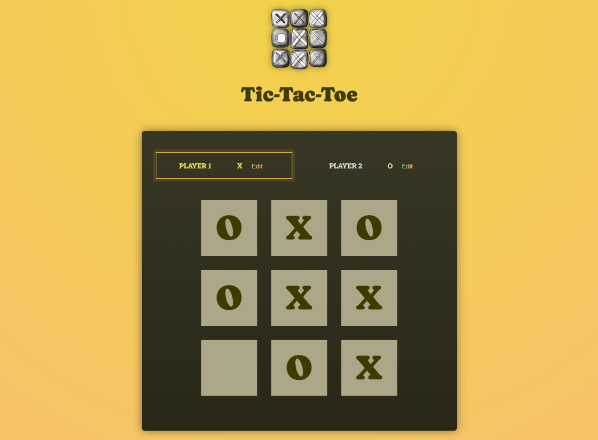

# Tic-Tac-Toe

Two-player tic-tac-toe in React, for two people sharing one screen. [Play it here](https://tic-tac-toe-gamma-roan.vercel.app/).



## What it does

- Players take turns placing X and O on a 3x3 board, and the active player is highlighted.
- Either player can rename themselves with the Edit button. Enter saves the name too.
- A log beside the board lists every move as the row and column picked.
- Three in a row ends the game with the winner's name, and a full board ends it as a draw. Rematch clears the board and keeps the names.

## How it works

The only game state is the list of turns. The board, the active player and the winner are all derived from it on each render, in `src/helpers.js`. The winning lines live in `src/winning-combinations.js`.

## Running it

You need Node.js and npm.

```
git clone https://github.com/janrizmlibres/tic-tac-toe.git
cd tic-tac-toe
npm install
npm run dev
```

`npm run build` writes a production build with Vite.

## Status

Finished. One known bug: a win on the ninth move is reported as a draw, since the full-board check runs before the win check.

## License

MIT. See [LICENSE](LICENSE).
